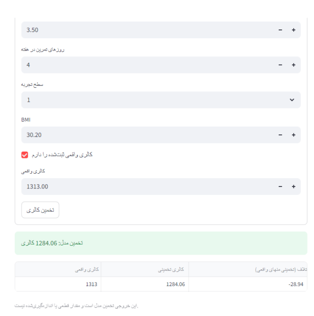

# Workout Calorie Estimator

A small machine learning project that estimates the calories recorded for a workout session. The result is a model estimate, not a direct or definitive measurement.

## Project Overview

This project explores workout and member data, compares regression models, analyzes prediction errors by workout type, and provides a local prediction interface through FastAPI and Streamlit.

## Project Structure

```text
.
├── app/
│   ├── api.py
│   └── streamlit_app.py
├── data/
│   └── gym_members_exercise_tracking.csv
├── docs/
│   └── streamlit_app.png
├── models/
│   └── calorie_model.joblib
├── notebooks/
│   ├── gym_members_exercise_tracking.ipynb
│   └── gym_members_exercise_tracking j.ipynb
├── .gitignore
├── README.md
└── requirements.txt
```

## Dataset

The dataset is the [Gym Members Exercise Dataset on Kaggle](https://www.kaggle.com/datasets/valakhorasani/gym-members-exercise-dataset). The project copy is stored at `data/gym_members_exercise_tracking.csv`.

## Modeling and Evaluation

The target variable is `Calories_Burned`. The data was split into training and test sets using an 80/20 split. Regression models were compared using MAE, RMSE, and R-squared. The initial comparison selected Linear Regression.

| Metric | Test result |
|---|---:|
| MAE | 30.27 calories |
| RMSE | 40.57 calories |
| R-squared | 0.980 |

The test-set results describe this particular split. The test set was also viewed during model comparison, so these scores should not be treated as a completely untouched final evaluation.

### Error by Workout Type

| Workout type | Test sessions | MAE (calories) | RMSE (calories) |
|---|---:|---:|---:|
| Strength | 47 | 28.32 | 38.02 |
| HIIT | 42 | 29.60 | 41.28 |
| Cardio | 46 | 30.49 | 40.21 |
| Yoga | 60 | 32.10 | 42.25 |

## Installation

Run these commands in PowerShell from the project root:

```powershell
python -m venv .venv
.venv\Scripts\Activate.ps1
python -m pip install -r requirements.txt
```

If PowerShell blocks virtual environment activation, use the Python executable inside the environment directly, for example `.venv\Scripts\python.exe -m pip install -r requirements.txt`.

## Run the API and App

Open two terminals in the project root. Keep the API running in the first terminal:

```powershell
python -m uvicorn app.api:app --reload
```

In the second terminal, start Streamlit:

```powershell
python -m streamlit run app/streamlit_app.py
```

The API provides `GET /health` and `POST /predict`. Interactive API documentation is available at `http://127.0.0.1:8000/docs` while the API is running. Streamlit calls the local API at `http://127.0.0.1:8000`.

## Demo Screenshot



## Limitations

- The model estimates the calories recorded in this dataset; it does not measure a person's actual energy expenditure.
- Prediction errors vary across sessions and workout types. MAE and RMSE summarize the test split and do not guarantee an individual prediction's error.
- The test set was inspected during model comparison, which limits how strongly the reported test scores can be interpreted as final unseen-data performance.
